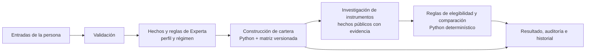

# NEXUS: cómo funciona el sistema experto

NEXUS es un prototipo educativo que transforma un perfil y un escenario ingresados por la persona en una **distribución porcentual ilustrativa**. Luego investiga instrumentos que podrían corresponder a cada categoría y explica qué hechos y reglas sostienen la selección.

El sistema combina datos y reglas explícitas. **No usa un modelo de lenguaje, aprendizaje automático ni un optimizador de rentabilidad.** La primera etapa usa [Experta](https://github.com/nilp0inter/experta) para inferir perfil y régimen; la distribución la calcula un módulo Python. La selección de instrumentos es otra etapa determinística en Python y depende de fuentes públicas con evidencia vigente. Son dos decisiones distintas: obtener porcentajes no garantiza que haya datos suficientes para seleccionar un instrumento.

> NEXUS es una demostración académica con revisión experta pendiente. No genera órdenes, no consulta un broker ni verifica que una cuenta pueda operar un instrumento. Los datos de mercado pueden estar demorados o incompletos; las selecciones no son una validación profesional de idoneidad.

## El flujo en dos etapas



1. **Asignación:** Experta infiere un perfil y un régimen a partir de las entradas. Python aplica la matriz, límites y controles de suma para producir porcentajes.
2. **Selección:** Python recopila registros públicos, comprueba sus hechos y aplica exclusiones y reglas de comparación. Esta etapa puede terminar sin candidato elegible, aunque la distribución porcentual sea válida.

La investigación no vuelve a calcular la cartera. Actualizar una investigación tampoco ejecuta de nuevo el motor de asignación.

### De respuestas a hechos y reglas

Experta mantiene una memoria de trabajo con hechos tipados. Al iniciar una evaluación, el servicio reinicia el motor, declara `Inversor` y `Mercado`, y `@DefFacts` incorpora `Parametros` con los umbrales de la matriz activa. Las reglas `@Rule` cotejan esos hechos; si una coincide, puede declarar un nuevo hecho como `Perfil` o `Regimen` y agregar una entrada a la auditoría.

Por ejemplo, con tolerancia 10, los parámetros `conservador_max=0` y `moderado_max=10` permiten que coincida esta regla:

```text
SI conservador_max < tolerancia <= moderado_max
ENTONCES declarar Perfil(nombre="MODERADO")
         registrar R_PERFIL_02 en la auditoría
```

El servicio llama a `run()`, que aplica encadenamiento hacia adelante: busca reglas cuyas condiciones ya coinciden con hechos y ejecuta sus acciones. Las reglas de perfil y régimen leen directamente los hechos de entrada; no se disparan una a otra en una cascada. Después, el servicio recoge los hechos `Perfil` y `Regimen` y se los pasa al módulo de cartera. La tolerancia determina el perfil; capital, horizonte y objetivo no lo cambian y se usan en la validación y los ajustes posteriores de la cartera.

La prioridad `salience` de Experta ordena activaciones de reglas. Es distinta de `prioridad_regimen` en la matriz, que decide cuál señal de escenario prevalece si hay varias. Esta prioridad configurable no altera el orden de evaluación del perfil.

## Entradas y efecto

| Entrada | Qué cambia |
| --- | --- |
| Tolerancia a una caída | Elige el perfil según los umbrales de la matriz. En v1: 0% conservador; mayor que 0% y hasta 10% moderado; mayor que 10% agresivo. También puede excluir instrumentos incompatibles con el perfil. |
| Capital y moneda | El capital se convierte a montos por categoría. La selección comprueba mínimos publicados y compatibilidad de la moneda de la clase o cotización; no calcula unidades para comprar ni confirma la moneda de fondeo del intermediario. |
| Horizonte | Afecta límites de renta variable y la compatibilidad de horizonte y duración de los FCI. |
| Objetivo | Preservación limita renta variable al 10%; Crecimiento y Renta no tienen ese tope en la política vigente. |
| Liquidez mínima | Fija el mínimo que debe quedar en Liquidez inmediata. Si hace falta, la cartera retira puntos de otras categorías según el orden de la matriz. |
| Señales de escenario | Inflación, presión cambiaria y volatilidad se ingresan manualmente. Si no se marca ninguna, el régimen es Estable. Si hay más de una, v1 elige un solo régimen según la prioridad configurable: volatilidad, inflación, presión cambiaria. |
| Confirmación del escenario | `mercado_actualizado` es el nombre de una confirmación manual de la demo. No consulta precios, fechas ni indicadores para comprobar que el escenario esté actualizado. |

La validación rechaza capital u horizonte no positivos, tolerancia o liquidez fuera de 0–100, la falta de confirmación manual y la combinación de tolerancia 0% con objetivo Crecimiento. También puede derivar un caso si faltan hechos inferidos o si las reglas no logran una cartera válida.

## Matriz de asignación: versión 1

La matriz base reparte 100 puntos entre cuatro categorías:

| Perfil | Renta fija inflación | Renta fija cambiaria | Renta variable | Liquidez inmediata |
| --- | ---: | ---: | ---: | ---: |
| Conservador | 60% | 20% | 0% | 20% |
| Moderado | 40% | 20% | 20% | 20% |
| Agresivo | 20% | 15% | 45% | 20% |

La versión vigente de la política agrega topes de renta variable después de los ajustes de matriz:

| Condición | Tope de renta variable |
| --- | ---: |
| Horizonte menor a 12 meses | 0% |
| Horizonte de 12 a 35 meses | 20% |
| Horizonte de 36 meses o más | Sin tope adicional por horizonte |
| Objetivo Preservación | 10% |
| Objetivo Crecimiento o Renta | Sin tope adicional por objetivo |

En cada evaluación, las operaciones se aplican en este orden:

1. Copiar la cartera base del perfil.
2. Aplicar el ajuste del régimen inferido: inflación mueve 10 puntos de liquidez a renta fija inflación; presión cambiaria mueve 10 puntos de liquidez a renta fija cambiaria; volatilidad mueve de renta variable a liquidez hasta todos los puntos disponibles. La prioridad selecciona un solo régimen.
3. Aplicar los topes de la matriz por perfil; cualquier excedente pasa a liquidez inmediata.
4. Aplicar el tope de renta variable por horizonte y objetivo; el excedente pasa a liquidez.
5. Elevar Liquidez inmediata al mínimo indicado, retirando puntos en el orden configurado.
6. Comprobar que ninguna categoría sea negativa y que el total sea exactamente 100%. Si no se puede cumplir, el resultado requiere revisión manual.

### Ejemplo reproducible

Supongamos un capital de **ARS 10.000**, horizonte de **24 meses**, objetivo **Preservación**, tolerancia **10%**, liquidez mínima **20%** y la señal manual **presión cambiaria**. Este cálculo usa la matriz v1 y no necesita consultar instrumentos ni la red.

1. 10% de tolerancia produce el perfil **Moderado**; su base es 40/20/20/20.
2. Presión cambiaria mueve 10 puntos de Liquidez inmediata a Renta fija cambiaria: 40/30/20/10.
3. El tope por horizonte de 24 meses es 20% de renta variable, así que no cambia la distribución.
4. Preservación limita Renta variable a 10%; los 10 puntos excedentes pasan a liquidez: **40/30/10/20**.
5. El mínimo de liquidez del 20% ya se cumple.

| Categoría | Porcentaje | Monto simulado |
| --- | ---: | ---: |
| Renta fija inflación | 40% | ARS 4.000 |
| Renta fija cambiaria | 30% | ARS 3.000 |
| Renta variable | 10% | ARS 1.000 |
| Liquidez inmediata | 20% | ARS 2.000 |

Los montos son porcentajes del capital ingresado. No son cantidades de instrumentos ni una predicción de resultados.

### Versiones de reglas y de conocimiento

La matriz se puede cambiar desde **Más opciones → Administración de matrices**. Guardar una edición o restaurar una versión crea una versión nueva; no sobrescribe las anteriores. Cada evaluación registra la versión que usó. Esto cambia las reglas de asignación futuras, no reescribe resultados guardados.

[`nexus/instrument_knowledge.py`](nexus/instrument_knowledge.py) contiene `KnowledgeStore`, que conserva fichas y evidencia de instrumentos con versiones e historial de señales. Ese almacén es independiente de la matriz de cartera: las señales no entrenan modelos, no cambian reglas y no validan una ficha por sí solas.

## Cómo se seleccionan los instrumentos

La matriz de cartera es una decisión versionada en [`config/matriz_decision.json`](config/matriz_decision.json). La política de selección actual es `argentina-4`, en [`config/instrument_policy.json`](config/instrument_policy.json). Las reglas ejecutables están en Python; la lista `ranking_order` del JSON no configura por sí sola el comparador.

El alcance actual es `ARGENTINA_SIN_BROKER`: FCI argentinos y valores BYMA de tipos admitidos. El proceso:

1. Reúne el universo de fuentes y completa las consultas dentro de límites de tiempo y cantidad.
2. Conserva los hechos faltantes como desconocidos y comprueba evidencia, fechas, moneda, mínimos, plazo y exposición.
3. Excluye candidatos que incumplen una regla; los datos contradictorios o inválidos requieren revisión.
4. Compara solo candidatos elegibles. Los hechos no comparables no se rellenan con cero. No se favorece un ticker, una marca ni una señal de familiaridad.
5. Conserva hasta dos opciones bajo el **mismo presupuesto de categoría**. La segunda es una alternativa y no una segunda posición añadida a la cartera.

En la implementación vigente, primero cuentan factores comunes —plazo publicado cuando está disponible y diversificación comprobada—. Dentro de FCI se comparan gastos anuales publicados y patrimonio de clase; dentro de valores BYMA se comparan spread y presencia observada. Entre tipos distintos se usan solo factores comunes y un desempate estable por identidad canónica. Riesgo comparable y familiaridad no están disponibles como factores de ranking en las fuentes inspeccionadas.

### Hechos, fechas y límites

- **CAFCI:** catálogo, planilla diaria y fichas de fondos. El VCP diario es por mil cuotapartes y no se convierte en `unit_price`. Patrimonio de clase no significa volumen negociado, seguridad ni liquidez en un broker.
- **BYMADATA:** observaciones de mercado público con demora. Una oferta observada no es una operación ejecutada ni necesariamente el último precio negociado.
- **Composición:** las fichas de fondos pueden publicar nombres y porcentajes con fecha propia. Para recomendar exposición CER o cambiaria, la política exige más de 50% de exposición explícita identificada en una composición publicada dentro de 35 días. Un mandato u objetivo del fondo no demuestra por sí solo su exposición actual.
- **Desconocido no significa cero:** un honorario, precio, lote, acceso o moneda de suscripción no publicados siguen sin dato. Los gastos anuales publicados del fondo no son comisiones de una orden ni un costo total en pesos.
- **Broker separado:** `execution_checks` mantiene por separado la disponibilidad, las condiciones y los costos que debe confirmar un intermediario. Una selección no implica que ese broker ofrezca el instrumento ni que una orden pueda ejecutarse.
- **Cripto:** la política no asigna Bitcoin ni vehículos de exposición a Bitcoin; tampoco existe una biblioteca cripto independiente en el resultado.

Las consultas guardadas conservan fecha de observación, fecha de los datos cuando existe, fuente, evidencia por campo y vencimiento. Entre los límites vigentes están hasta 7 días para hechos CAFCI, 35 días para composición y 15 minutos para observaciones de mercado BYMA. Los umbrales son reglas provisionales del prototipo, no una política experta validada.

### Estados de salida

La asignación y la selección tienen estados distintos:

| Estado | Significado |
| --- | --- |
| `RECOMENDACION_EXITOSA` | La etapa de asignación produjo porcentajes válidos. No garantiza que la investigación encuentre instrumentos elegibles. |
| `DERIVADO_ASESOR_MANUAL` | La etapa de asignación no pudo continuar con sus entradas o reglas. No se contacta ni asigna un asesor real. |
| `CONSERVAR_CANDIDATO` | En una categoría se conserva el candidato elegible con mejor posición según los hechos comparables. |
| `PROPONER_ALTERNATIVA_COMPATIBLE` | Se elige otro candidato elegible; el motivo y la comparación quedan en la auditoría. |
| `INFORMACION_INSUFICIENTE` | Faltan hechos requeridos o evidencia vigente para seleccionar. |
| `REQUIERE_REVISION` | Hay datos contradictorios o inválidos. |
| `AMPLIAR_BUSQUEDA` | Evento intermedio: se buscan otros candidatos dentro del presupuesto de consultas. No es una selección final. |
| `EXCLUIR` | El candidato incumple una regla del alcance de recomendación del instrumento. |
| `EXCLUIR_CANDIDATO` | Descartado por reglas del modo estricto o por duplicación de subyacente; el alcance actual también registra `EXCLUIR`. |

No se promete que todas las categorías terminen con una selección.

## Auditoría, JSON e historial

Cada resultado conserva entradas congeladas, perfil y régimen, versión de matriz, versión de política, porcentajes, motivos y estado. El JSON descargable y la auditoría permiten revisar esa ejecución después, aunque se modifiquen borradores.

La investigación de instrumentos se guarda como una revisión separada. Actualizarla conserva el resultado previo y no cambia sus porcentajes. Las señales de ficha —**Entendí**, **Ya lo conocía** o **Señalar un dato**— quedan como feedback local para futuras revisiones; no entrenan un modelo ni validan financieramente un instrumento.

El historial y las revisiones usan SQLite en el servidor bajo `data/` o `NEXUS_DATA_DIR`. El identificador de usuario sirve para filtrar el historial, no autentica a la persona ni aísla sus datos.

## Mapa del código

| Archivo | Responsabilidad |
| --- | --- |
| [`nexus/engine.py`](nexus/engine.py) | Hechos y reglas Experta para perfil y régimen. |
| [`nexus/service.py`](nexus/service.py) | Validación, ejecución del motor y armado de resultado. |
| [`nexus/portfolio.py`](nexus/portfolio.py) | Aplicación ordenada de matriz, topes y liquidez. |
| [`nexus/validation.py`](nexus/validation.py) | Validaciones de entrada antes de ejecutar. |
| [`config/matriz_decision.json`](config/matriz_decision.json) | Matriz inicial versionada y prioridad de regímenes. |
| [`config/instrument_policy.json`](config/instrument_policy.json) | Alcance y límites de la política de instrumentos. |
| [`nexus/instrument_research.py`](nexus/instrument_research.py) | Descubrimiento, evidencia, límites de búsqueda e historial de investigación. |
| [`nexus/instrument_recommendations.py`](nexus/instrument_recommendations.py) | Elegibilidad, exclusiones, ranking y decisiones por categoría. |
| [`nexus/cafci.py`](nexus/cafci.py), [`nexus/byma_public.py`](nexus/byma_public.py) | Adaptadores de hechos públicos CAFCI y BYMADATA. |
| [`nexus/history.py`](nexus/history.py) | Persistencia de evaluaciones y revisiones SQLite. |
| [`nexus/instrument_knowledge.py`](nexus/instrument_knowledge.py) | Versiones e historial de fichas, evidencia y feedback de instrumentos. |
| [`docs/instrument-research.md`](docs/instrument-research.md), [`docs/instrument-policy.md`](docs/instrument-policy.md) | Alcance de fuentes, evidencia y reglas detalladas. |

## Instalar, ejecutar y comprobar

Desde la carpeta del proyecto, instalá las dependencias:

```bash
python -m pip install -r requirements.txt
```

Iniciá Streamlit:

```bash
python -m streamlit run app.py
```

La aplicación abrirá una dirección local, normalmente `http://localhost:8501`. Para ejecutar las pruebas existentes:

```bash
python -m unittest discover -s tests -v
```

La interfaz necesita conexión para consultar fuentes públicas. Las pruebas usan fixtures y no dependen de Internet. El historial y las versiones se escriben en el disco del servidor; en hosting con disco efímero se pierden al reiniciar o redesplegar, salvo que se configure un `NEXUS_DATA_DIR` persistente.
