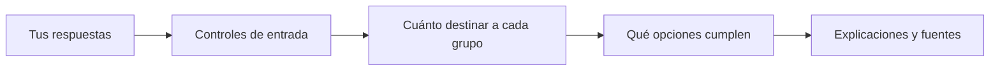

# NEXUS: qué decide y cómo lo hace

NEXUS es un prototipo educativo que usa **reglas escritas por personas** para convertir tus respuestas en una distribución porcentual ilustrativa. Después busca instrumentos que podrían corresponder a cada categoría y muestra los datos usados.

Primero calcula porcentajes; luego evalúa instrumentos. Puede producir una cartera porcentual aunque no encuentre datos suficientes para recomendar instrumentos. No calcula rendimientos futuros ni optimiza ganancias.

NEXUS no analiza balances de empresas ni valuaciones, ni intenta anticipar qué empresa rendirá mejor. Selecciona instrumentos por compatibilidad con las reglas y los datos disponibles.

> La revisión experta de las reglas está pendiente. NEXUS no genera órdenes ni consulta a tu intermediario. No comprueba si tu cuenta puede operar un instrumento. Los datos pueden estar demorados o incompletos.

## Qué significan estos términos

- **Perfil:** clasificación que se obtiene de tu tolerancia a una caída.
- **Cartera:** distribución del capital entre grupos, como renta fija o liquidez. Los porcentajes no son cantidades de instrumentos.
- **Horizonte:** cuánto tiempo pensás mantener la inversión.
- **Liquidez:** porción que querés dejar en el grupo de dinero disponible según la simulación.
- **Renta variable:** acciones y fondos cuyo valor puede cambiar con el mercado.
- **Matriz:** tabla que indica cómo repartir el capital para cada perfil.
- **Escenario:** señales manuales que describen el contexto supuesto, como presión cambiaria. No son un pronóstico.

Para más términos cotidianos, consultá el [glosario](docs/glosario.md).

## Cómo usarlo

1. Indicá tolerancia, capital, horizonte, objetivo y liquidez mínima.
2. Confirmá el escenario manual y revisá las respuestas.
3. Ejecutá la evaluación para ver porcentajes y, cuando haya evidencia suficiente, instrumentos seleccionados.
4. Revisá los motivos, pendientes y fuentes. La investigación de instrumentos se puede actualizar sin recalcular los porcentajes.

La confirmación del escenario es manual: NEXUS no verifica con indicadores reales que el mercado esté actualizado.

## El flujo en dos etapas



1. **Reparto:** la tolerancia determina el perfil. La tabla de reparto, el tiempo previsto, el objetivo y la liquidez fijan los porcentajes.
2. **Opciones:** el sistema revisa datos publicados para ver qué instrumentos cumplen. Puede no mostrar una opción si los datos no alcanzan.

La investigación no vuelve a calcular la cartera. Actualizar una investigación tampoco ejecuta de nuevo el motor de asignación.

## Cómo pasa de tus respuestas a una cartera

En la práctica, la tolerancia decide el perfil. Capital convierte porcentajes en montos; horizonte, objetivo y liquidez aplican límites después. El ejemplo completo y reproducible está más abajo.

## Entradas y efecto

| Entrada | Qué cambia |
| --- | --- |
| Tolerancia a una caída | Elige el perfil según los umbrales de la matriz. En v1: 0% conservador; mayor que 0% y hasta 10% moderado; mayor que 10% agresivo. También puede excluir instrumentos incompatibles con el perfil. |
| Capital y moneda | El capital se convierte a montos por categoría. La selección compara los mínimos y la moneda indicada para el instrumento con la moneda simulada. No calcula unidades para comprar ni comprueba qué moneda acepta tu intermediario para pagar. |
| Horizonte | Afecta límites de renta variable y la compatibilidad de horizonte y duración de los FCI. |
| Objetivo | Preservación limita renta variable al 10%; Crecimiento y Renta no tienen ese tope en la política vigente. |
| Liquidez mínima | Fija el mínimo que debe quedar en Liquidez inmediata. Si hace falta, la cartera retira puntos de otras categorías según el orden de la matriz. |
| Señales de escenario | Inflación, presión cambiaria y volatilidad se ingresan manualmente. Si no se marca ninguna, se toma el escenario estable. Si hay varias, se aplica el orden vigente: volatilidad, inflación y presión cambiaria. |
| Confirmación del escenario | Confirmás manualmente el escenario de la demostración. NEXUS no consulta precios, fechas ni indicadores para comprobar que esté actualizado. |

Antes de calcular, la aplicación revisa que el capital y el tiempo sean mayores que cero, que tolerancia y liquidez estén entre 0% y 100%, que hayas confirmado el escenario y que las respuestas sean compatibles. Si no puede obtener un perfil o un reparto válido, explica que el caso necesita revisión.

## Matriz de asignación: versión 1

La matriz base reparte 100 puntos entre cuatro categorías:

| Perfil | Renta fija inflación | Renta fija cambiaria | Renta variable | Liquidez inmediata |
| --- | ---: | ---: | ---: | ---: |
| Conservador | 60% | 20% | 0% | 20% |
| Moderado | 40% | 20% | 20% | 20% |
| Agresivo | 20% | 15% | 45% | 20% |

La versión vigente de la política agrega topes de renta variable después de los ajustes de matriz:

| Condición | Tope de renta variable |
| --- | ---: |
| Horizonte menor a 12 meses | 0% |
| Horizonte de 12 a 35 meses | 20% |
| Horizonte de 36 meses o más | Sin tope adicional por horizonte |
| Objetivo Preservación | 10% |
| Objetivo Crecimiento o Renta | Sin tope adicional por objetivo |

En cada evaluación, las operaciones se aplican en este orden:

1. Copiar la cartera base del perfil.
2. Aplicar el ajuste del escenario elegido: inflación mueve 10 puntos de liquidez a renta fija inflación; presión cambiaria mueve 10 puntos de liquidez a renta fija cambiaria; volatilidad mueve de renta variable a liquidez hasta todos los puntos disponibles. Si hay varias señales, se aplica una sola según su prioridad.
3. Aplicar los topes de la matriz por perfil; cualquier excedente pasa a liquidez inmediata.
4. Aplicar el tope de renta variable por horizonte y objetivo; el excedente pasa a liquidez.
5. Elevar Liquidez inmediata al mínimo indicado, retirando puntos en el orden configurado.
6. Comprobar que ninguna categoría sea negativa y que el total sea exactamente 100%. Si no se puede cumplir, el resultado requiere revisión manual.

### Ejemplo reproducible

Supongamos un capital de **ARS 10.000**, horizonte de **24 meses**, objetivo **Preservación**, tolerancia **10%**, liquidez mínima **20%** y la señal manual **presión cambiaria**. Este cálculo usa la matriz v1 y no necesita consultar instrumentos ni la red.

1. 10% de tolerancia produce el perfil **Moderado**; su base es 40/20/20/20.
2. Presión cambiaria mueve 10 puntos de Liquidez inmediata a Renta fija cambiaria: 40/30/20/10.
3. El tope por horizonte de 24 meses es 20% de renta variable, así que no cambia la distribución.
4. Preservación limita Renta variable a 10%; los 10 puntos excedentes pasan a liquidez: **40/30/10/20**.
5. El mínimo de liquidez del 20% ya se cumple.

| Categoría | Porcentaje | Monto simulado |
| --- | ---: | ---: |
| Renta fija inflación | 40% | ARS 4.000 |
| Renta fija cambiaria | 30% | ARS 3.000 |
| Renta variable | 10% | ARS 1.000 |
| Liquidez inmediata | 20% | ARS 2.000 |

Los montos son porcentajes del capital ingresado. No son cantidades de instrumentos ni una predicción de resultados.

## Versiones de la tabla de reparto

La tabla se puede cambiar desde **Más opciones → Administración de matrices**. Guardar una edición o restaurar una versión crea una versión nueva; no reemplaza las anteriores. Cada evaluación registra qué versión usó. Un cambio afecta evaluaciones futuras y no altera resultados guardados.

## Cómo se seleccionan los instrumentos

La selección usa hechos publicados para filtrar candidatos y comparar los que pasan las reglas. Si los datos no alcanzan, puede no haber selección. El intermediario y los costos de ejecutar una orden quedan pendientes de confirmar. Las fichas y fechas se explican en [investigación de instrumentos](docs/instrument-research.md); los umbrales están en la [política de recomendación](docs/instrument-policy.md).

La selección revisa si la información permite comparar instrumentos y si cada uno cumple las condiciones de su grupo. Puede dejar un grupo sin opción. Si muestra una alternativa, usa el mismo presupuesto de ese grupo; no suma una segunda inversión a la cartera. La descripción sencilla de filtros y fuentes está en [política](docs/instrument-policy.md) e [investigación](docs/instrument-research.md).

<details>
<summary>Datos y estados técnicos de la selección</summary>

### Hechos, fechas y límites

- **CAFCI:** catálogo, planilla diaria y fichas de fondos. El VCP diario es por mil cuotapartes y no se convierte en `unit_price`. Patrimonio de clase no significa volumen negociado, seguridad ni liquidez en un broker.
- **BYMADATA:** observaciones de mercado público con demora. Una oferta observada no es una operación ejecutada ni necesariamente el último precio negociado.
- **Composición:** las fichas de fondos pueden publicar nombres y porcentajes con fecha propia. Para recomendar exposición CER o cambiaria, la política exige más de 50% de exposición explícita identificada en una composición publicada dentro de 35 días. Un mandato u objetivo del fondo no demuestra por sí solo su exposición actual.
- **Desconocido no significa cero:** un honorario, precio, lote, acceso o moneda de suscripción no publicados siguen sin dato. Los gastos anuales publicados del fondo no son comisiones de una orden ni un costo total en pesos.
- **Broker separado:** `execution_checks` mantiene por separado la disponibilidad, las condiciones y los costos que debe confirmar un intermediario. Una selección no implica que ese broker ofrezca el instrumento ni que una orden pueda ejecutarse.
- **Cripto:** la política no asigna Bitcoin ni vehículos de exposición a Bitcoin; tampoco existe una biblioteca cripto independiente en el resultado.

Las consultas guardadas conservan fecha de observación, fecha de los datos cuando existe, fuente, evidencia por campo y vencimiento. Entre los límites vigentes están hasta 7 días para hechos CAFCI, 35 días para composición y 15 minutos para observaciones de mercado BYMA. Los umbrales son reglas provisionales del prototipo, no una política experta validada.

### Estados de salida

La asignación y la selección tienen estados distintos:

| Estado | Significado |
| --- | --- |
| `RECOMENDACION_EXITOSA` | La etapa de asignación produjo porcentajes válidos. No garantiza que la investigación encuentre instrumentos elegibles. |
| `DERIVADO_ASESOR_MANUAL` | La etapa de asignación no pudo continuar con sus entradas o reglas. No se contacta ni asigna un asesor real. |
| `CONSERVAR_CANDIDATO` | En una categoría se conserva el candidato elegible con mejor posición según los hechos comparables. |
| `PROPONER_ALTERNATIVA_COMPATIBLE` | Se elige otro candidato elegible; el motivo y la comparación quedan en la auditoría. |
| `INFORMACION_INSUFICIENTE` | Faltan hechos requeridos o evidencia vigente para seleccionar. |
| `REQUIERE_REVISION` | Hay datos contradictorios o inválidos. |
| `AMPLIAR_BUSQUEDA` | Evento intermedio: se buscan otros candidatos dentro del presupuesto de consultas. No es una selección final. |
| `EXCLUIR` | El candidato incumple una regla del alcance de recomendación del instrumento. |
| `EXCLUIR_CANDIDATO` | Descartado por reglas del modo estricto o por duplicación de subyacente; el alcance actual también registra `EXCLUIR`. |

No todas las categorías necesariamente terminan con una opción.

</details>

## Auditoría, JSON e historial

Cada resultado conserva entradas congeladas, perfil y régimen, versión de matriz, versión de política, porcentajes, motivos y estado. El JSON descargable y la auditoría permiten revisar esa ejecución después, aunque se modifiquen borradores.

La investigación de instrumentos se guarda como una revisión separada. Actualizarla conserva el resultado previo y no cambia sus porcentajes. Las señales de ficha —**Entendí**, **Ya lo conocía** o **Señalar un dato**— quedan como feedback local para futuras revisiones; no entrenan un modelo ni validan financieramente un instrumento.

El historial y las revisiones usan SQLite en el servidor bajo `data/` o `NEXUS_DATA_DIR`. El identificador de usuario sirve para filtrar el historial, no autentica a la persona ni aísla sus datos.

<details>
<summary>Para quien quiera ver el código</summary>

## Detalles de implementación

NEXUS no usa un modelo de lenguaje ni aprendizaje automático. La asignación usa Experta para inferir perfil y régimen, y Python aplica la matriz. La selección de instrumentos es un módulo Python determinístico separado. El detalle de hechos, reglas y prioridades se encuentra en [`nexus/engine.py`](nexus/engine.py); las reglas de instrumentos, en [`nexus/instrument_recommendations.py`](nexus/instrument_recommendations.py).

Experta mantiene una memoria de trabajo de hechos tipados. Al iniciar una evaluación, el servicio reinicia el motor, declara `Inversor` y `Mercado`, y `@DefFacts` incorpora `Parametros` con los umbrales de la matriz activa. Las reglas `@Rule` cotejan esos hechos; al coincidir, pueden declarar `Perfil` o `Regimen` y agregar una entrada a la auditoría.

Por ejemplo, con tolerancia 10, `conservador_max=0` y `moderado_max=10` permiten que coincida esta regla:

```text
SI conservador_max < tolerancia <= moderado_max
ENTONCES declarar Perfil(nombre="MODERADO")
         registrar R_PERFIL_02 en la auditoría
```

El servicio llama a `run()`, que aplica encadenamiento hacia adelante: coteja las condiciones con los hechos presentes y ejecuta las acciones correspondientes. Las reglas de perfil y régimen leen directamente los hechos de entrada; no se disparan una a otra en cascada. El servicio recoge los hechos `Perfil` y `Regimen` y se los pasa al módulo de cartera. La tolerancia determina el perfil; capital, horizonte y objetivo se usan después en la validación y los ajustes de cartera.

`salience` ordena activaciones de reglas Experta. `prioridad_regimen` es un ajuste distinto de la matriz que elige una señal de escenario cuando hay varias; no cambia el orden de evaluación del perfil.

El campo `mercado_actualizado` guarda la confirmación manual del escenario. No verifica que los datos de mercado sean actuales.

La matriz se guarda en [`config/matriz_decision.json`](config/matriz_decision.json); la política vigente es `argentina-4` en [`config/instrument_policy.json`](config/instrument_policy.json). El campo `ranking_order` no configura por sí solo el comparador. El alcance técnico se llama `ARGENTINA_SIN_BROKER`.

[`nexus/instrument_knowledge.py`](nexus/instrument_knowledge.py) contiene `KnowledgeStore`, que guarda fichas y evidencia versionadas e historial de señales. Es independiente de la matriz. Las señales no entrenan modelos, no cambian reglas ni validan fichas por sí solas.

### Mapa del código

| Archivo | Responsabilidad |
| --- | --- |
| [`nexus/engine.py`](nexus/engine.py) | Hechos y reglas Experta para perfil y régimen. |
| [`nexus/service.py`](nexus/service.py) | Validación, ejecución del motor y armado de resultado. |
| [`nexus/portfolio.py`](nexus/portfolio.py) | Aplicación ordenada de matriz, topes y liquidez. |
| [`nexus/validation.py`](nexus/validation.py) | Validaciones de entrada antes de ejecutar. |
| [`config/matriz_decision.json`](config/matriz_decision.json) | Matriz inicial versionada y prioridad de regímenes. |
| [`config/instrument_policy.json`](config/instrument_policy.json) | Alcance y límites de la política de instrumentos. |
| [`nexus/instrument_research.py`](nexus/instrument_research.py) | Descubrimiento, evidencia, límites de búsqueda e historial de investigación. |
| [`nexus/instrument_recommendations.py`](nexus/instrument_recommendations.py) | Elegibilidad, exclusiones, ranking y decisiones por categoría. |
| [`nexus/cafci.py`](nexus/cafci.py), [`nexus/byma_public.py`](nexus/byma_public.py) | Adaptadores de hechos públicos CAFCI y BYMADATA. |
| [`nexus/history.py`](nexus/history.py) | Persistencia de evaluaciones y revisiones SQLite. |
| [`nexus/instrument_knowledge.py`](nexus/instrument_knowledge.py) | Versiones e historial de fichas, evidencia y feedback de instrumentos. |
| [`docs/instrument-research.md`](docs/instrument-research.md), [`docs/instrument-policy.md`](docs/instrument-policy.md) | Alcance de fuentes, evidencia y reglas detalladas. |

</details>

## Instalar, ejecutar y comprobar

Desde la carpeta del proyecto, instalá las dependencias:

```bash
python -m pip install -r requirements.txt
```

Iniciá Streamlit:

```bash
python -m streamlit run app.py
```

La aplicación abrirá una dirección local, normalmente `http://localhost:8501`. Para ejecutar las pruebas existentes:

```bash
python -m unittest discover -s tests -v
```

La interfaz necesita conexión para consultar fuentes públicas. Las pruebas usan fixtures y no dependen de Internet. El historial y las versiones se escriben en el disco del servidor; en hosting con disco efímero se pierden al reiniciar o redesplegar, salvo que se configure un `NEXUS_DATA_DIR` persistente.
